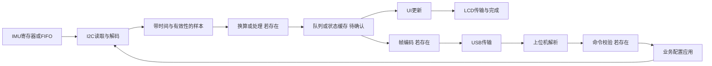

# ESP32-S3-Touch-LCD-1.69 架构阅读问题清单

> 用途：带着具体问题读代码，解释启动、采样、调度、通信与显示怎样协作。
> 边界：未读取用户实际仓库。本文是阅读与验证指南，不是现有项目的架构结论。
> 官方资料核对日期：2026-11-22。

## 如何使用

使用标准 Markdown `- [ ]` 语法，可直接在 Obsidian 中勾选。完成调查并记录证据后才改为 `- [x]`；勾选表示问题已调查，不表示功能必须存在。

- **【通用参考】**：文中的目录、API、搜索词、架构模式与官方资料，帮助定位，均不保证实际工程采用。
- **【待源码确认】**：所有项目行为、引脚、频率、任务、协议和依赖的初始状态。
- **【源码已证实】**：自行补充仓库版本、文件、符号或行号后使用。
- **【运行已验证】**：补充固件、条件、结果及日志/抓包证据后使用。
- 找不到先记“未定位”；确认不存在再记“不适用＋依据”，不要仅凭文件名判断。
- 不预设 ESP-IDF、Arduino、LVGL、TinyUSB、姿态融合或自定义通信协议已被采用。
- 本文所有建议源码入口均是【通用参考】，不是用户仓库中的已知路径。
- 推荐第一遍追调用主线，第二遍读驱动细节、并发边界与错误分支。

每题可在下面缩进记录“结论、证据、待办”，也可使用统一表：

| 问题编号 | 结论/疑点 | 证据：提交、文件、符号/行号 | 运行记录 | 状态/下一步 |
|---|---|---|---|---|
| S05-04 | 待填 | 待定位 | 未验证 | 待源码确认 |

## 阅读顺序

| 顺序 | 模块 | 阶段产出 |
|---|---|---|
| 1 | S01 工程 → S02 启动 | 确认正在编译的固件和启动主线 |
| 2 | S03 硬件 → S04 I2C → S05 IMU | 追通一个有单位、有时间含义的样本 |
| 3 | S06 FreeRTOS → S07 定时器 | 解释谁在何时运行、在哪里等待 |
| 4 | S08 数据 → S09 USB → S10 LCD | 追通上传、显示和命令回流 |
| 5 | S11 依赖 → S12 验证 | 完成有证据的架构说明与验收记录 |

## S01｜工程身份与构建边界

**建议源码入口【通用参考】**：README、CMakeLists.txt、main/、components/、idf_component.yml、dependencies.lock、sdkconfig、sdkconfig.defaults、分区表；Arduino 项目查看 .ino、libraries/、platformio.ini。

- [ ] S01-01：正在阅读的是独立应用、官方单项示例，还是多个示例的集合？实际构建哪个子目录？
- [ ] S01-02：仓库地址、分支、提交号和本地修改是什么？后续证据能否固定到这个版本？
- [ ] S01-03：实际采用 ESP-IDF、Arduino，还是 Arduino 作为 IDF 组件？SDK、Core 和关键依赖版本如何确认？
- [ ] S01-04：目标芯片、板卡修订版、Flash、PSRAM、分区和控制台配置在哪里定义？
- [ ] S01-05：哪些源文件真正加入构建，哪些是旧文件或未启用示例？条件编译最终选择哪套实现？
- [ ] S01-06：能否按现有说明构建、烧录并看到启动日志？需要哪些工具版本和配置？

**本节验收**：能准确说出正在研究哪个固件，留下可复现的构建步骤；没有源码时保持待确认。

## S02｜启动入口与初始化

**建议源码入口【通用参考】**：ESP-IDF 搜索 app_main；Arduino 搜索 setup/loop；继续查 init、begin、board、bsp 和任务创建位置。

- [ ] S02-01：应用入口在哪里？从入口出发初始化与任务创建按什么顺序执行？
- [ ] S02-02：配置、总线、器件、队列、显示和通信之间有哪些先后依赖？消费者会不会早于资源就绪运行？
- [ ] S02-03：应用入口最终返回、永久循环还是删除自身？loop 承担了什么工作？
- [ ] S02-04：哪些初始化只执行一次，哪些会在重连或错误恢复后重复执行？重复调用是否安全？
- [ ] S02-05：关键初始化失败时是终止、重试还是降级？失败如何被用户或上位机看到？
- [ ] S02-06：默认参数来自常量、构建配置还是持久化存储？缺失和非法参数怎样处理？

**本节验收**：画出带真实函数名的启动链，标出创建的资源、执行上下文和失败去向；应用入口不等于复位后的第一条指令。

## S03｜硬件与板级配置

**建议源码入口【通用参考】**：匹配修订版的原理图、板级头文件、pin_config、board_config、bsp、GPIO 宏与驱动初始化参数。

- [ ] S03-01：实物丝印、原理图与目标配置是否都是 ESP32-S3-Touch-LCD-1.69 的同一修订版？是否误用了非 Touch 或其他屏幕型号资料？
- [ ] S03-02：LCD、背光、触摸、QMI8658C、USB 和其他已用外设分别通过什么接口连接？
- [ ] S03-03：每个使用中的引脚定义在哪里？与原理图是否一致，有无复用冲突？
- [ ] S03-04：QMI8658C 的型号、I2C 地址、供电和中断连接如何确认？代码中的简称是否对应实物？
- [ ] S03-05：LCD 控制器、分辨率、方向、偏移、颜色格式及背光控制在哪里配置？
- [ ] S03-06：触摸控制器使用哪条总线？是否与 IMU、RTC 等实际存在的设备共用 I2C？
- [ ] S03-07：Type-C 的数据线接到原生 USB、桥接芯片还是其他电路？能否分别解释电源路径与数据路径？

**本节验收**：填好器件—接口—引脚/地址—定义位置—原理图版本映射；不填未经核对的固定 GPIO 或地址。

## S04｜I2C 总线与器件访问

**建议源码入口【通用参考】**：搜索 i2c、Wire、readRegister、writeRegister。新版 IDF 可能使用 i2c_new_master_bus / i2c_master_transmit_receive，旧版可能使用 i2c_driver_install；按实际版本识别。

- [ ] S04-01：总线由谁创建、拥有和释放？传给哪些驱动，是否重复初始化？
- [ ] S04-02：SDA/SCL、总线速率、地址表示方式和超时单位是什么？软件与硬件上拉是否匹配？
- [ ] S04-03：一次寄存器读取经过哪些封装？寄存器地址长度、重复起始、连续读取与返回码如何处理？
- [ ] S04-04：并发访问由驱动、总线封装还是应用锁保护？多步事务能否被其他调用插入？
- [ ] S04-05：超时、NACK 和总线异常如何传回业务层？重试次数、错误计数及恢复入口在哪里？
- [ ] S04-06：通信失败后是否仍把旧缓冲区当作新数据？有效状态在哪里维护？

**本节验收**：沿器件接口→总线封装→SDK/库追通一次真实事务，并解释错误传播与共享总线保护。

## S05｜QMI8658C 从寄存器到样本

**建议源码入口【通用参考】**：搜索 QMI8658、SensorLib、WHO_AM_I、accel、gyro、ODR、range、FIFO、data ready；寄存器定义按匹配型号的数据手册核对。

- [ ] S05-01：识别、复位、配置和启用的顺序是什么？身份检查失败后如何处理？
- [ ] S05-02：量程、输出数据率、滤波和 FIFO 是否启用？最终生效参数来自哪里？
- [ ] S05-03：采集由轮询、数据就绪中断还是 FIFO 水位触发？实际实现是哪一种？
- [ ] S05-04：原始字节如何组合成带符号数？字节序、灵敏度换算和最终物理单位如何确认？
- [ ] S05-05：传感器坐标轴、板卡坐标轴和屏幕方向怎样对应？轴交换与符号翻转在哪里发生？
- [ ] S05-06：时间戳表示数据产生、FIFO 取出还是任务读取时间？六轴数据是否来自同一周期？
- [ ] S05-07：器件 ODR、读取频率和有效新样本率分别是多少？如何发现重复、遗漏和 FIFO 溢出？
- [ ] S05-08：若存在校准、温漂补偿或姿态融合，其输入、状态和参数在哪里？若没有，是否明确只输出六轴数据？
- [ ] S05-09：静止与受控运动时能否验证单位、轴方向和符号？静止加速度模长是否接近重力，陀螺仪是否处于合理零偏范围？

**本节验收**：解释样本来源、单位、坐标系、时间意义与有效性；不把六轴 IMU 等同于可靠绝对航向。

## S06｜FreeRTOS 任务与同步

**建议源码入口【通用参考】**：搜索 xTaskCreate、xTaskCreatePinnedToCore、队列、信号量、通知、事件组和互斥量；同时检查库内部创建的任务。

- [ ] S06-01：除应用显式任务外，显示、USB 与系统组件还创建哪些任务？运行时能否观察到？
- [ ] S06-02：每个任务的入口、职责、优先级、栈参数、核心亲和性与阻塞点是什么？栈单位是否按当前 SDK 确认？
- [ ] S06-03：采样、解析、显示和上传如何唤醒彼此？队列、通知或事件组分别传递什么信息？
- [ ] S06-04：队列容量、发送/接收超时及满队列策略是什么？阻塞是否反向拖慢采样？
- [ ] S06-05：样本、配置、I2C 和 GUI 对象由谁读写？什么机制保证一致性，是否误把 volatile 当作同步？
- [ ] S06-06：是否持锁做慢速 I/O 或等待另一任务？多把锁的获取顺序是否可能形成死锁？
- [ ] S06-07：高优先级任务是否长时间不阻塞？低优先级任务是否可能饥饿，如何从统计验证？
- [ ] S06-08：中断到任务是否使用适用的 FromISR 接口？是否需要请求调度，通知失败如何处理？
- [ ] S06-09：任务栈余量、运行时间及看门狗如何观测？停止/重建任务如何释放资源？

**本节验收**：完成任务表，解释何时运行、何时阻塞、共享资源怎样保护。ESP-IDF 支持 SMP 也可配置单核，实际模式需确认。

## S07｜定时器与时间基准

**建议源码入口【通用参考】**：搜索 xTimerCreate、esp_timer_create、dispatch_method、gptimer、vTaskDelay、xTaskDelayUntil / vTaskDelayUntil、millis、micros、lv_tick_inc。

- [ ] S07-01：工程有哪些时间来源，分别负责采样、业务周期、GUI 时间推进还是刷新处理？
- [ ] S07-02：每个回调运行在 ISR、定时器服务任务还是普通任务？创建参数与配置能否证明？
- [ ] S07-03：周期单位是 tick、毫秒还是微秒？换算和取整是否改变目标周期？
- [ ] S07-04：回调仅发通知还是执行 I2C、日志、USB 或 GUI 操作？这些调用是否适合当前上下文，耗时是否受控？
- [ ] S07-05：周期任务使用绝对时间基准还是工作结束后再延时？超时后是积压、跳过还是补跑？
- [ ] S07-06：器件采样、任务读取、上传与刷新频率是否独立？最慢环节怎样影响延迟？
- [ ] S07-07：停止/删除定时器、计数回绕或休眠恢复时，会不会补触发或访问已释放对象？
- [ ] S07-08：能否记录目标触发、实际执行和完成时间，计算抖动与最坏耗时？

**本节验收**：区分定时到期与业务执行；列出时间机制、执行上下文、周期、回调工作与实测耗时。

## S08｜数据模型与业务数据流

**建议源码入口【通用参考】**：样本结构体、时间戳、序号、有效标记、队列、环形缓冲区、状态缓存和消费者。

- [ ] S08-01：样本包含哪些字段？原始值、物理量、时间戳、序号和有效性是否分开表达？
- [ ] S08-02：一次 IMU 读取到屏幕数值经过哪些真实函数、任务与缓冲区？
- [ ] S08-03：同一份样本到上位机接收经过哪些编码、缓存与传输步骤？尚无上传时缺口在哪里？
- [ ] S08-04：交接传值还是传指针？内存由谁分配、持有和释放，会不会被生产者过早覆盖？
- [ ] S08-05：UI 和上传能否看到一致快照？是否可能读取半更新样本或不同轴的不同时刻值？
- [ ] S08-06：消费者需要最新状态还是每个样本？覆盖、丢旧值或背压策略是否符合各自目标？
- [ ] S08-07：上位机命令由哪个任务真正应用到采样配置或 UI？是否存在竞态或部分生效？
- [ ] S08-08：错误如何传到业务状态、屏幕与上位机？旧数据是否被标为过期？

**本节验收**：为两条数据流和命令回流标出真实节点、上下文、缓冲区与所有权；不存在的路径标为未实现。

## S09｜USB Type-C 与上下位机通信

**建议源码入口【通用参考】**：搜索 usb_serial_jtag、tinyusb、tud_cdc、USBSerial、USBHID、Serial、uart、stdio 重定向、描述符与收发回调；主机侧查端口打开、帧解析和界面更新。

- [ ] S09-01：实际链路是原生 USB Serial/JTAG、USB OTG 设备类、USB-UART 桥还是仅供电？原理图、配置与主机枚举是否一致？
- [ ] S09-02：烧录、调试、日志和业务数据分别走哪条通道？共用时日志是否会破坏业务帧？
- [ ] S09-03：若显示为串口，波特率设置对该链路有什么实际作用？是否误将它当作 USB 吞吐率？
- [ ] S09-04：USB 栈和端点由谁初始化？收发回调在哪个上下文运行，重处理是否交给任务？
- [ ] S09-05：若有业务协议，帧边界、长度、命令字、版本、序号、校验及应答在哪里定义？若没有，是否记录缺口而不编造格式？
- [ ] S09-06：字段宽度、符号、字节序、浮点表示和单位如何规定？是否直接发送有填充或 ABI 差异的 C 结构体？
- [ ] S09-07：字节流方案如何处理拆包、粘包和重新同步？HID 等方案如何按实际报告/传输规则处理？
- [ ] S09-08：数据不完整、长度非法、校验失败、未知或重复命令如何处理？缓冲边界是否受控？
- [ ] S09-09：主机不读取、缓冲满、部分写入、断开和重连时会怎样？采样是否被无限阻塞？
- [ ] S09-10：每帧字节数×发送频率加协议开销得到多大数据率？吞吐与丢帧如何实测？
- [ ] S09-11：上位机接收、解析、模型与界面线程怎样交接？没有主机源码时，哪些端到端结论仍不能确认？

**本节验收**：把一次真实收发对应到设备编码与主机解析；明确 Type-C 接口形态、传输实现、业务协议是三个层次。

## S10｜LCD、GUI 与触摸

**建议源码入口【通用参考】**：搜索 esp_lcd、SPI、panel、flush、DMA、draw buffer、LVGL、lv_timer_handler、lv_tick_inc、ui_init、TFT_eSPI、Arduino_GFX；仅进入实际使用的库。

- [ ] S10-01：采用直接绘图还是 GUI 框架？底层驱动、框架适配、页面与业务边界在哪里？
- [ ] S10-02：面板命令、方向、颜色格式和偏移由谁设置？背光打开前是否完成初始化？
- [ ] S10-03：若用 LVGL，其版本、tick 来源与处理函数在哪里？时间推进是否被误当成刷新？
- [ ] S10-04：哪些任务调用 GUI API？采用单一 UI 任务还是匹配版本的锁机制，是否可能重复加锁？
- [ ] S10-05：数据如何变成文字或图形？数值格式化、页面更新与底层传输是否分层？
- [ ] S10-06：刷新缓冲大小、内存位置与所有权是什么？DMA 能力、对齐和缓存要求是否满足当前驱动？
- [ ] S10-07：异步传输结束前会不会复用缓冲？若用 LVGL，flush 完成通知由谁在何时调用？
- [ ] S10-08：触摸采集、坐标变换和事件回调在哪层？旋转屏幕后映射是否一致？
- [ ] S10-09：全屏刷新、日志与 I2C 竞争是否影响 UI？UI 是否按所需频率消费最新数据？
- [ ] S10-10：如何区分没有新样本与屏幕没有刷新？显示或触摸初始化失败后其他业务如何运行？

**本节验收**：追通样本→UI 数据→控件/绘图→flush→传输完成，并说明线程、缓冲与触摸映射。

## S11｜模块依赖、资源与异常

**建议源码入口【通用参考】**：组件构建声明、头文件、公开 API、malloc/free、heap_caps、NVS、错误码、日志与看门狗。

- [ ] S11-01：构建依赖、实际调用和共享资源关系分别是什么？是否把 include 当作运行时调用？
- [ ] S11-02：板级配置、总线、驱动、业务、通信与 UI 是否有明确边界？是否存在驱动反向调用 UI 的耦合？
- [ ] S11-03：是否重复定义配置、全局样本或总线实例？真正的资源所有者是谁？
- [ ] S11-04：栈、GUI、采样与通信缓存各占多少内存？PSRAM 与内部 RAM 的限制是否按实际库核实？
- [ ] S11-05：重连、换页或重复初始化是否持续分配对象？如何观察堆下降或碎片化？
- [ ] S11-06：持久化配置何时写入，是否校验版本与范围？是否可能高频写 Flash？
- [ ] S11-07：重试、降级和复位由哪层决定？看门狗复位能否追到具体阻塞或饥饿证据？
- [ ] S11-08：Wi-Fi、蓝牙、RTC、电源管理、存储或 OTA 是否实际启用并影响主链路？未启用模块如何有依据地排除？

**本节验收**：区分调用、构建与资源三类依赖，能指出修改一个参数会影响哪些位置。

## S12｜运行验证与最终验收

**建议源码入口【通用参考】**：现有日志、运行统计、时间戳、错误计数、协议序号、抓包和现有测试入口；不假设已经执行。

- [ ] S12-01：能否用一页内容说明启动、模块和数据流，并为关键连线标注源码证据？
- [ ] S12-02：能否用一份真实六轴样本及换算结果解释单位和坐标轴？
- [ ] S12-03：能否分别测出新样本率、任务周期、上传率和刷新率，而不是只引用配置常量？
- [ ] S12-04：能否记录采样到入发送缓存、采样到 UI 更新的设备端延迟？主机与设备时钟未同步时，是否避免直接相减推断单向延迟？
- [ ] S12-05：能否通过序号与计数区分采样遗漏、队列丢弃、传输丢失和解析丢弃？没有诊断字段时缺口是什么？
- [ ] S12-06：主机停止读取后恢复、USB 断开后重连，采样、显示与通信是否符合已确认目标？
- [ ] S12-07：通过可恢复的软件故障注入模拟 I2C 失败，能否观察错误上报、样本失效与恢复？
- [ ] S12-08：已有协议能否拒绝截断帧、非法长度和未知命令，并继续解析？没有协议时是否注明不适用？
- [ ] S12-09：并发运行时能否记录 CPU、栈、堆、队列峰值、最大延迟和丢弃数？负载与持续时间是否明确？
- [ ] S12-10：改变采样率、降低刷新率或新增上位机命令，各需修改哪些真实位置并做什么验证？

**本节验收**：能回答谁初始化、谁产生、谁消费、何时执行、在哪里等待、失败如何处理；关键结论有源码和运行证据，未知项仍明确标注。

## 待验证的数据流参考图

下面只是帮助追代码的模型，**不代表用户工程的真实架构**。实际代码可能是单任务直连、共享缓存，或者根本没有上传功能。阅读后替换成真实模块名，并在连线上注明同步/异步、队列/通知/函数调用、数据所有权。

需要分别追清楚三条链路：

1. **显示链路**：样本生成 → 处理 → UI 数据交接 → 页面更新 → 像素传输 → 完成通知。
2. **上传链路**：样本生成 → 协议编码 → 发送缓存 → 实际传输 → 主机解析 → 主机显示/存储。
3. **控制链路**：主机命令 → 接收与校验 → 命令分发 → 配置应用 → 应答/状态反馈。没有实现则标注缺口。

## 建议填写的架构表

### 硬件与配置映射

| 器件 | 接口/控制器 | 引脚/地址 | 定义位置 | 原理图版本 | 状态 |
|---|---|---|---|---|---|
| QMI8658C | 待确认 | 待确认 | 待定位 | 待确认 | 待源码确认 |
| LCD/背光 | 待确认 | 待确认 | 待定位 | 待确认 | 待源码确认 |
| 触摸 | 待确认 | 待确认 | 待定位 | 待确认 | 待源码确认 |
| USB | 待确认 | 待确认 | 待定位 | 待确认 | 待源码确认 |

### 模块依赖

不要把构建依赖、运行时调用、共享资源访问混成同一种箭头。

| 真实模块 | 对外 API | 依赖模块/关系类型 | 拥有资源 | 调用者/执行上下文 | 失败处理 |
|---|---|---|---|---|---|
| 待定位 | 待确认 | 待确认 | 待确认 | 待确认 | 待确认 |

### 任务调度

任务、定时器回调和 ISR 分开记录；不预填假想任务名或优先级。

| 真实任务名/入口 | 职责 | 优先级/核心亲和性 | 栈参数及单位 | 触发/周期 | 输入→输出 | 阻塞/持锁点 |
|---|---|---|---|---|---|---|
| 待定位 | 待确认 | 待确认 | 待确认 | 待确认 | 待确认 | 待确认 |

### 时间机制

| 时间来源/回调 | 类型/执行上下文 | 周期及单位 | 回调工作 | 唤醒任务 | 最坏耗时/抖动 |
|---|---|---|---|---|---|
| 待定位 | 待确认 | 待确认 | 待确认 | 待确认 | 未测 |

### 数据交接与所有权

| 数据/缓冲 | 生产者 | 消费者 | 传值/指针及同步方式 | 生命周期/释放者 | 满/过期策略 |
|---|---|---|---|---|---|
| 待定位 | 待确认 | 待确认 | 待确认 | 待确认 | 待确认 |

### 协议记录

仅抄录真实实现；没有业务协议时明确写未实现。

| 消息/命令 | 方向 | 格式/字节序/单位 | 触发条件 | 应答/超时 | 编码与解析位置 |
|---|---|---|---|---|---|
| 待确认 | 待确认 | 待确认 | 待确认 | 待确认 | 待定位 |

### 运行验收记录

具体数值阈值先从需求或现有实现确认；没有要求时先测基线，再注明建议目标。下面是建议验证场景，未声称已执行。硬件异常优先使用可恢复的软件故障注入，不带电拆接板载器件。

| 场景 | 固件/配置 | 输入与持续时间 | 预期与阈值来源 | 实测/证据 | 结论/风险 |
|---|---|---|---|---|---|
| 静止与受控运动 | 待填 | 待填 | 待确认 | 未执行 | 待验证 |
| 正常并发运行 | 待填 | 待填 | 待确认 | 未执行 | 待验证 |
| 主机停止读取/恢复 | 待填 | 待填 | 待确认 | 未执行 | 待验证 |
| USB 断连/重连 | 待填 | 待填 | 待确认 | 未执行 | 待验证 |
| I2C 失败/恢复 | 待填 | 待填 | 待确认 | 未执行 | 待验证 |
| 协议异常输入 若适用 | 待填 | 待填 | 待确认 | 未执行 | 待验证 |

## 关键概念与官方资料

下列是【通用参考】，链接核对日期为 2026-11-22；SDK 的 stable 页面会变化，请切换到实际工程版本。官方示例也不等同于用户仓库。

- **板卡身份与示例**：官方提供 ESP-IDF 和 Arduino 示例方向；先确认所用分支和工程。参见 [Waveshare 板卡说明](https://docs.waveshare.com/ESP32-S3-Touch-LCD-1.69) 与[官方公开示例仓库](https://github.com/waveshareteam/ESP32-S3-Touch-LCD-1.69)。本文未把公开仓库视为用户的实际代码。
- **硬件版本**：从[官方资源与文档](https://docs.waveshare.com/ESP32-S3-Touch-LCD-1.69/Resources-And-Documents)查找原理图和 QMI8658 数据手册，再与实物核对；不要混用 Touch、非 Touch 及其他尺寸资料。
- **调度**：ESP-IDF FreeRTOS 支持 SMP，也可配置单核；芯片有双核不代表应用必然按双核运行。参见[官方 FreeRTOS 文档](https://docs.espressif.com/projects/esp-idf/en/stable/esp32s3/api-reference/system/freertos_idf.html)。
- **定时器**：FreeRTOS 软件定时器、esp_timer、硬件 GPTimer、GUI tick 与周期任务需分别识别。esp_timer 可按配置在专用任务或 ISR 上下文分派回调；不能一律当作中断或普通业务任务。参见[官方 ESP Timer 文档](https://docs.espressif.com/projects/esp-idf/en/stable/esp32s3/api-reference/system/esp_timer.html)。
- **USB**：Type-C 是接口形态。ESP32-S3 的 USB Serial/JTAG 是固定功能控制器，与可配置的 USB OTG 方案不同；工程实际链路要结合电路和配置确认。参见[官方 USB Serial/JTAG 文档](https://docs.espressif.com/projects/esp-idf/en/stable/esp32s3/api-guides/usb-serial-jtag-console.html)。

## 阅读完成后的交付检查

- [ ] D01：是否已保存版本信息、实际构建入口和可复现步骤？
- [ ] D02：是否已完成真实启动链、硬件映射、模块依赖、任务与定时器表？
- [ ] D03：是否已画出显示、上传和命令回流的实际数据流，并标明缺失路径？
- [ ] D04：是否已记录样本/协议字段、单位、坐标系、内存所有权与异常传播？
- [ ] D05：是否已保存验证基线、异常测试结果及按影响排序的未确认问题？

**最终边界**：实际框架、目录、引脚、任务数量、采样率、GUI、USB 模式、协议和主机实现，均需取得对应源码与硬件版本后确认。这份清单本身不证明设备功能已实现或验证通过。
